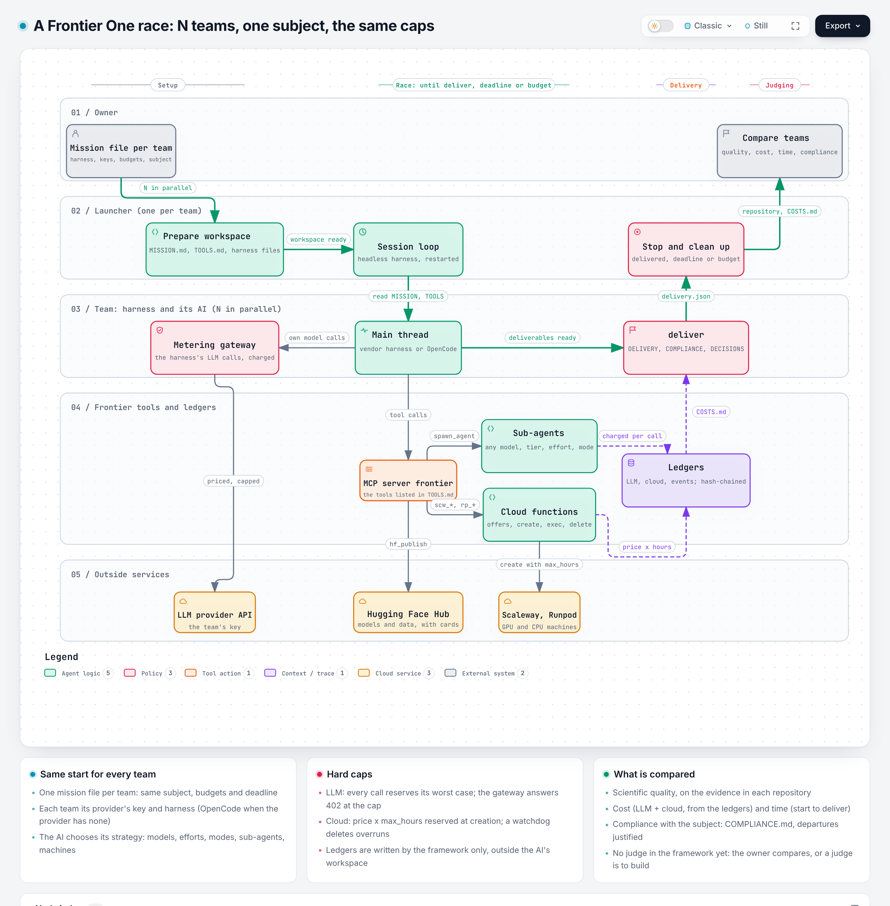

# Frontier

Frontier hands a research mission to an AI and lets the AI run it end to end. The owner gives four things:

- **A harness.** The harness is a coding agent that the launcher can run headless. The providers' own harnesses
  are Claude Code, Codex CLI, Antigravity, Gemini CLI, Grok Build, Kimi Code, Qwen Code, Mistral Vibe, DeepSeek
  dsh, and ZCode. The community harnesses are Hermes and OpenCode. A provider without its own harness gets
  OpenCode.
- **An LLM API key with a budget.**
- **Scaleway and Runpod API keys with budgets**, and optionally a **Hugging Face token**.
- **The subject** (here an M2 internship subject) and a deadline.

The AI decides its own strategy: models, reasoning levels, speed modes, sub-agents, machines, and scope. The
framework does the rest:

- It gives the main thread a complete inventory of its tools (`TOOLS.md`).
- It enforces the budgets and measures cost and time.
- It checks the deliverables: the report, the code, the models or data on the Hub, a compliance matrix of the
  subject's instructions, and a decision log.

A race is N such missions run in parallel, one per provider and harness, on the same subject with the same caps.



The previous race framework is in git history:
[`old/` at 7223bd6](https://github.com/knoel99/frontier-one/tree/7223bd6f39eaddce278457a0d0d32f3598f600b3/old).

## Run a mission

Frontier needs Python 3.11 or later and the standard library only. Publishing needs `huggingface_hub`, the `sympy`
tool needs SymPy (`pip install sympy`), and rebuilding the catalog needs PyYAML.

1. Copy the example. Fill in the harness, the budgets, the subject, and the `[secrets]` sources.

   ```bash
   cp config/mission.example.toml my-mission.toml
   ```

2. Write the workspace and check the key, without starting the harness.

   ```bash
   python3 -m frontier mission start my-mission.toml --prepare-only
   ```

3. Start the mission. The launcher runs the harness headless, session after session, until delivery.

   ```bash
   python3 -m frontier mission start my-mission.toml
   ```

4. Read the spend, the commitments, and the time left.

   ```bash
   python3 -m frontier mission status my-mission.toml
   ```

5. On the host, run the dead-man sweep from cron. It deletes what overran its `max_hours` or its budget.

   ```bash
   frontier reap ~/.frontier/missions/<name>
   ```

`python3 -m frontier` has these other commands:

| Command | What it does |
|---|---|
| `plan` | lists the models and reasoning values of every provider and tier |
| `ping` | checks model ids, reasoning values, and tool calls with tiny requests |
| `run` | runs an API agent on a task, without a harness |
| `tools` | lists the tools |
| `call <tool> '<json>'` | calls one tool from a shell |
| `docs search …` | searches the cloud API catalog |
| `harnesses` | lists the supported harnesses and the files generated for each |
| `dashboard` | serves the live dashboard of a race |
| `jury` | grades and ranks the teams of a race |
| `mission red-flag <state> --minutes N --reason TEXT` | takes N minutes off a team's time, for the stewards |
| `cleanup` | deletes the resources that a run left alive |

To test a change, run `python3 -m pytest`, `python3 -m ruff check .`, and `python3 tools/sync_harnesses.py --check`.

## What the AI gets

| | |
|---|---|
| `MISSION.md` | The brief (`prompts/mission.md`): the task, the evaluation, the budgets and the deadline, the deliverables, and the rules. It states that the strategy is the AI's. |
| `TOOLS.md` | The generated inventory: the harness and its model, every Frontier tool, every model usable through `spawn_agent` with its price per million tokens, its reasoning values and its speed modes, a snapshot of GPU offers with price and stock on Scaleway and Runpod, the billing facts, and the budgets. |
| the `frontier` MCP server | `spawn_agent` starts a sub-agent on any model API of the mission's providers, with a tier, a reasoning level, a speed mode, and its own instructions and tools. The cloud functions (`scw_*`, `rp_*`) give offers with real prices, create with `max_hours`, run commands, read logs, and delete with leftovers. The server also has `budget_status`, `hf_publish`, `sympy` (symbolic algebra and calculus), `deliver`, the API catalog, and raw calls. |
| the harness's own files | Instructions, MCP config, sub-agents, and skills in the format of the chosen harness. |

`roles/` holds two presets only: `infra` (a cloud operator) and `reviewer` (tries to refute a result). The AI can
define any other sub-agent with `spawn_agent(instructions=…)`.

## How a mission is scored

`frontier/scoring.py` gives a score out of 100:

- **50 for scientific quality**: soundness, significance, positioning, and clarity, times the adequacy to the
  subject.
- **25 for code and data**: reproducibility, code, data, and traceability (ACM badges, FAIR).
- **25 for efficiency**: total spend, local CPU billed, and time, on log scales, absolute and against the teams
  whose science is comparable.

The stewards' penalties come off the total. Snapshots at fixed times and spends draw quality against time and
money.

## Budgets, cost, and time

- **LLM.** The framework prices every model call of the mission from `config/prices.toml` and writes it to a
  hash-chained ledger. `tools/update_prices.py` refreshes the list prices from OpenRouter's public list. The
  framework charges sub-agents directly. The harness's own traffic goes through a local pass-through metering
  gateway (`frontier/gateway.py`) when the harness lets its base URL be set (`config/harnesses.toml`). Otherwise
  the launcher reads the spend from the harness's usage report after each session.
- **The LLM cap.** Each call reserves its worst case before it starts, so parallel calls cannot pass the cap
  together. The cap holds while a call costs at most what it reserved (`docs/STANDARDS.md`, section 2).
- **Cloud.** Every machine is created with a `max_hours`, and the budget reserves price × `max_hours`. Spend is
  price × lifetime, from the ledger. A watchdog deletes what overruns. The launcher deletes the leftovers at the
  end.
- **Time.** The clock runs from the start of the mission to `deliver`. `deliver` freezes the clock and the spend
  and writes `COSTS.md`.
- **Second line.** Set provider-side caps too: an OpenAI project hard limit, an Anthropic workspace limit, an
  OpenRouter key limit, a prepaid Runpod balance with auto-pay off. Scaleway has alerts only.

The mission's state lives outside the AI's workspace, in `~/.frontier/missions/<name>/`. Only the framework
writes it.

## Keys come from declared sources

Nobody types a key by hand, and no key is written down.

- `config/providers.toml` declares what each key opens: a model provider's `key_env` and `base_url`, and under
  `[services.*]` a service's `env`, `hosts`, `header`, and non-secret `settings`. A new provider or cloud is a
  config entry.
- The mission's `[secrets]` section declares where each value comes from: `env:NAME`, `file:PATH` (Docker,
  Kubernetes, or systemd secrets), `cmd:COMMAND` (any secret manager's CLI), or `proxy` (an outer proxy injects
  the key, as in a Claude Code cloud session).
- The launcher resolves the keys once, on the host, under their standard names (`frontier/credentials.py`).
  `mission.json` records only where each key came from.

## Sandbox and network lists

With `[sandbox] kind = "openshell"` in the mission file, each team's harness runs in an
[NVIDIA OpenShell](https://docs.nvidia.com/openshell/) sandbox (`frontier/sandbox.py`). A mission ran its session
inside an OpenShell 0.1.8 sandbox and delivered on 2026-11-15.

- **Keys never enter the sandbox.** Each key the mission uses becomes an OpenShell provider backed by a profile
  of Frontier's. Inside the sandbox, the key's variable holds a placeholder. OpenShell's proxy replaces the
  placeholder with the real key only on the way to that service's hosts, in that service's header.
- **The network is denied by default.** The sandbox allows the providers' hosts, the package registries, Hugging
  Face storage, and the mission's `[network] allow` list (read-only, enforced at L7). `[network] deny` removes
  hosts from that list. A wildcard that covers a denied host is dropped, with a warning. Landlock (required, not
  best effort) and seccomp confine files and processes. The workload runs as the `sandbox` user.
- **The launcher drives the sandbox from the host.** It imports the profiles and creates the providers and the
  sandbox. The sandbox image is built from a generated Dockerfile with the harness and this repository. The
  launcher uploads the workspace and the state, then runs each session with
  `openshell sandbox exec … frontier mission session`. After each session it downloads the workspace and the
  ledgers, which the host's dashboard, watchdog, and commits read. At the end it deletes the sandbox and the
  providers. `mission start <file> --dry-run` prints every command without running it.
- **Check the host before a real mission.** Run one short session on the race host.
  `docs/TEST-RESULTS.md` lists the host setup that the live run needed. The policy's `binaries` globs must match
  the image's real paths: add a harness's native binary with `sandbox_binaries` in `config/harnesses.toml`.

Without a sandbox, an outbound filter (`frontier/egress.py`) refuses the hosts of `[network] deny`. It refuses a
host whole, because it cannot see paths inside TLS. `config/providers.toml` adds the organizer's own deny list to
every mission.

## Speed and price modes

`spawn_agent(mode=…)` and the inventory list the documented modes (`config/providers.toml`, read 2026-11-14):

| Provider | Modes |
|---|---|
| OpenAI | `flex` (×0.5, slower), `fast` (×2, up to 2.5× faster), `ultrafast` (×6) |
| Anthropic | `fast` (×2, Fable 5.2) |
| Gemini | `flex` (×0.5), `priority` (×1.8) |
| xAI | `priority` (×2) |
| Kimi, GLM | `highspeed`, `flashx` (faster sibling models) |

DeepSeek is half price outside its peak hours, and the budget applies that discount by itself. The gateway bills
the tier that the response says was served: a request for a fast tier can be served at standard.

## What was checked live

`docs/TEST-RESULTS.md` holds the verdict of each feature with its evidence, the defects found and fixed, and what
stays open. `docs/TEST-PLAN.md` holds the method. The live checks are in `tools/verify_live.py`.

- Eleven harnesses each delivered a live mission through the gateway on 2026-11-15: Claude Code, Codex, Gemini
  CLI, Antigravity, Grok Build, Kimi Code, Qwen Code, dsh, OpenCode, ZCode, and Hermes.
- Mistral Vibe reaches the gateway, then its Mistral account refuses the request.
- The other twelve harnesses get project files only, with no launch recipe (`docs/HARNESSES.md`).
- With every key left to the session's proxy, key checks, `spawn_agent`, and gateway-metered calls ran on
  openai, google, deepseek, and zhipu on 2026-11-14: 12 calls, all priced exactly, ledgers intact, no key on
  disk.

## Diagrams

Each diagram has an interactive HTML version: download it and open it in a browser. Every box links to the code
it describes.

1. [A race](docs/diagrams/race.html) ([PNG](docs/diagrams/race.png)): N missions in parallel. The boxes link to
   commit `7100fc2`.
2. [Run order](docs/diagrams/run-order.html) ([PNG](docs/diagrams/run-order.png)): the owner's one command,
   `mission.prepare`, the gateway and watchdog threads, the session loop and its three stop conditions, then
   delivery or cleanup.
3. [Processes](docs/diagrams/processes.html) ([PNG](docs/diagrams/processes.png)): the processes alive during a
   race, the code each one executes, and the workspace, state, and Frontier files each one reads or writes.
4. [One session](docs/diagrams/session.html) ([PNG](docs/diagrams/session.png)): the harness reads its
   instructions and starts the MCP server. Then come one model call through the gateway, `scw_create_instance`,
   `spawn_agent`, `deliver`, and the end of the session.

Diagrams 2 to 4 follow one team, and their boxes link to commit `6d76c7e`. The sources are
`docs/diagrams/<name>.archify.json`, rendered with [archify](https://github.com/tt-a1i/archify) 3.2 at commit
`7e45f36`:

```bash
node <archify>/bin/archify.mjs finalize <workflow|architecture|sequence> docs/diagrams/<name>.archify.json docs/diagrams/<name>.html --repo-root . --quality showcase
```

`race` and `run-order` are `workflow` diagrams, `processes` is `architecture`, and `session` is `sequence`.

## Repository layout

| Path | What it holds |
|---|---|
| `frontier/` | The framework, one module per job. Models: `llm.py` (one chat API over OpenAI Responses, Chat Completions, Gemini, and Anthropic), `agent.py` (the agent loop, runs, `spawn_agent`), `tools.py`. Money: `budget.py`, `gateway.py`, `milestones.py`, `snapshots.py`. Cloud: `infra.py` (cloud functions, watchdog), `catalog.py`, `hf.py`, `http.py`. Missions: `mission.py`, `launcher.py`, `credentials.py`, `sandbox.py`, `egress.py`, `status.py`. Harnesses: `harnesses.py` (files per harness), `mcp.py` (stdio MCP server). Races: `jury.py`, `scoring.py`, `dashboard.py`. |
| `config/` | `providers.toml` (models per tier, reasoning values, speed modes, limits), `prices.toml`, `harnesses.toml` (launch recipes), `mission.example.toml` |
| `catalog/` | the Scaleway and Runpod API catalog (one signature per operation) and a guide per provider |
| `prompts/`, `roles/` | the brief, the system prompts, the two role presets |
| `docs/` | `HARNESSES.md` (what each harness reads and gets), `STANDARDS.md` (industry standards and where Frontier stands), `TEST-PLAN.md`, `TEST-RESULTS.md`, `diagrams/` |
| `tools/` | `build_catalog.py`, `update_prices.py`, `sync_harnesses.py`, `verify_live.py` (the live checks), `check_model.py` |
| `formal/` | the TLA+ model of the LLM reservations and how to check it |
| `tests/` | the unit tests, the code rules (`test_rules.py`), and every order of parallel model calls (`test_call_orders.py`) |
| `bin/` | `frontier`, `frontier-mcp`: run from anywhere |
| harness files | `CLAUDE.md`, `.mcp.json`, `.codex/`, `.agents/`, `.claude/`, `.gemini/`, `.grok/`, `.kimi-code/`, `.qwen/`, `.vibe/`, `.dsh/`, `.github/`, `.cursor/`, `opencode.json`, `.opencode/`, `.crushrc`, `.kilo/`, `.devin/`, `.amp/`, `.continue/`, `.zed/`, `.clinerules/`, `.aider.conf.yml`. `tools/sync_harnesses.py` generates them, so this repository works in any of the 24 harnesses. |
