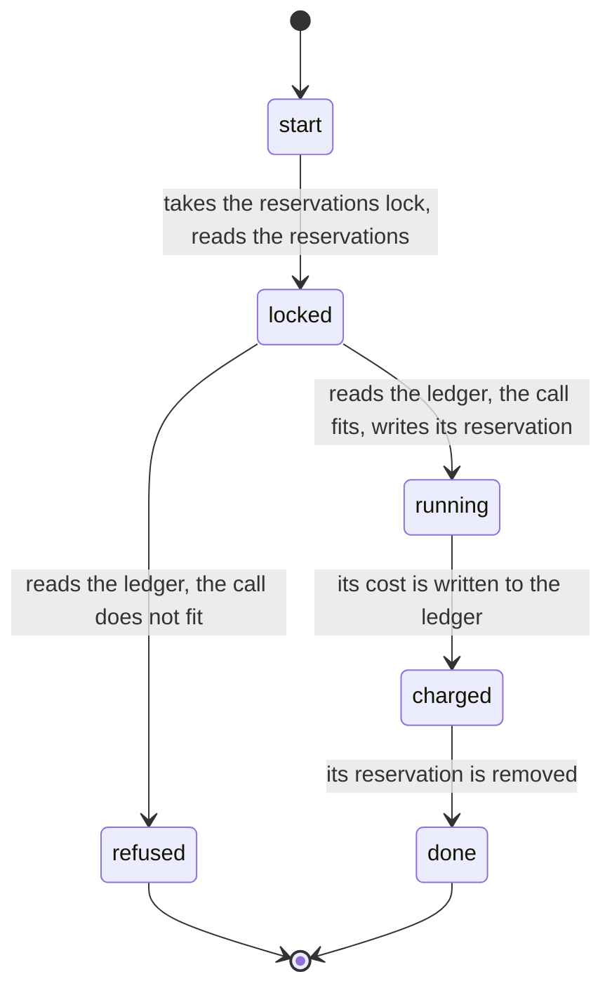

# The model of the LLM reservations

`Reservations.tla` is a TLA+ model of how `frontier/budget.py` reserves the worst case of each model call. TLC, the
TLA+ model checker, tries every order of the steps of several calls.

## What is checked

- **The promise.** Model calls made in parallel never spend more than the LLM cap together (`WithinCap`).
- **The harm when it breaks.** A mission overruns its budget, and nobody sees it before the bill.
- **Why it holds.** A call is counted at its worst case until its charge is written (`Covered`).
- **No leftover.** When every call has ended, no reservation is left (`NothingLeft`).

## One call, step by step



Each arrow is one action of the model and one step that the code takes with no other process in between.

| Action | Code | Why it is one step |
|---|---|---|
| `TakeLock` | `Budget._reservations`: takes `.reservations.lock`, reads `reservations.json` | the lock |
| `Decide` | `Budget.reserve` and `Budget._fits`: reads the ledger, writes the reservation or refuses, gives the lock back | still under the lock |
| `Charge` | `Budget.charge_llm`, from `Call.charge` or from `Call.__exit__` for a call nobody settled | one line appended under the ledger's lock |
| `Release` | `Budget.release`: removes the reservation | takes and gives back the lock |

Another call's `Charge` can fall between `TakeLock` and `Decide`. `tests/test_call_orders.py` cannot show that
order, because it stops the real code only before each lock.

## Run it

```bash
python3 tools/check_model.py
```

The command needs Java 11 or later. It downloads the TLA+ tools 1.7.4 once and checks their SHA-256. CI runs it.

```
ok  code: holds
    1417 distinct states found
ok  release_first: refuted
ok  ledger_first: refuted
```

`code` is the model of the code: it must hold. The two others are mistakes, and TLC must refute them. A check
that never fails proves nothing.

- `release_first` releases the reservation before the charge is written, as `agent.py` did before e6eead1.
- `ledger_first` reads the ledger before it takes the lock, so the spend that it saw can be stale.

## When the code changes

The model covers these functions of `frontier/budget.py`, as they were at commit `b98b580`: `Budget.call`,
`Budget.reserve`, `Budget.release`, `Budget._reservations`, `Budget._fits`, `Budget.charge_llm`, and `Call`.

When a change touches one of them:

1. Run `python3 -m pytest tests/test_call_orders.py`. That test runs every order of the steps on the code itself,
   so it follows the code without any edit.
2. If the change moves a read, a write, or a lock, change the matching action in `Reservations.tla`. Then run
   `python3 tools/check_model.py`.
3. Update the commit named above.

When `code` is refuted, TLC prints the steps that break the rule. Read them against the table above.

- If an action no longer describes the code, the model is wrong: correct the action.
- If every action describes the code, the code breaks the promise: correct the code. Do not weaken the rule.

## Bounds and assumptions

- Three calls, a cap of 5 units, and a worst case of 2 units for each call. A call costs any whole amount from 0
  to its worst case. A void call is a cost of 0.
- **A call costs at most what it reserved.** The gateway reserves at most `limits.max_reserved_output_tokens` of
  output, and a text can hold more than a token per four characters. Such a call overruns the cap by the excess
  (`docs/STANDARDS.md`, section 2).
- A call ends before its reservation expires (`RESERVATION_TTL_S`, two hours). The gateway waits one hour at most.
- Spend written with `charge_llm` alone is outside the reservations by design. A harness that cannot be routed
  through the gateway reports its usage at the end of a session.
- The model has no clock, no crash, and no change of the cap during a mission.
